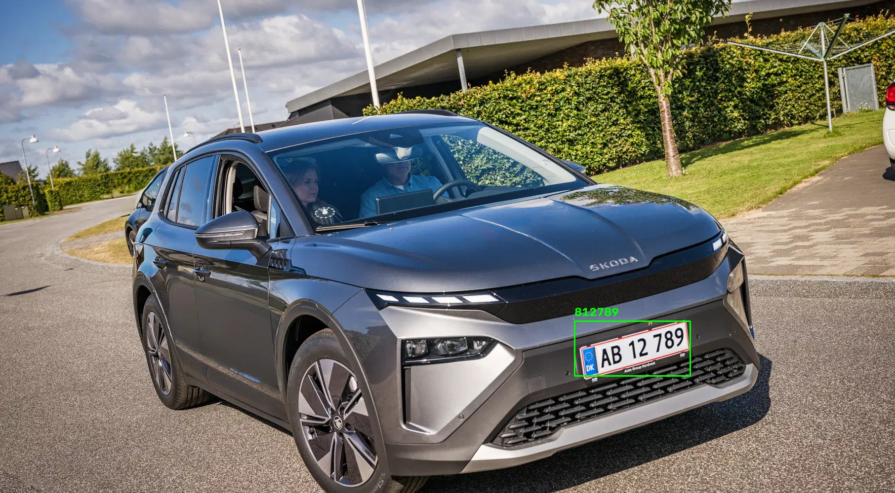

# Automatic License Plate Recognition (ALPR)

A small machine learning project that finds license plates in photos and tries to read the characters on them.

It's still a work in progress, so far spanish plates are working somehwta reliably, but the plan is to extend the training data to encompass multible countries within the EU.



## How it works

The system uses **two YOLO models**, each with a separate job:

1. **Plate detection:** finds license plates in a vehicle image.
2. **Character recognition:** looks at each detected plate and identifies its letters and numbers.

The detected characters are put in reading order and returned to the web app. The result is shown on the uploaded image, with a box around each detected plate.

The project is based on the [UC3M-LP dataset](https://github.com/ramajoballester/UC3M-LP), which provides annotated vehicle images for training. Training and inference use Python, PyTorch, and Ultralytics YOLO.

## What's in the repository?

```text
ALPR/
├── ALPRApp/               # Visual Studio project and ML development work
├── alpr_webui/            # Web frontend and FastAPI backend
├── test_car.jpg           # Example input image
├── test_car_result.jpg    # Example annotated result
└── .gitignore
```

The web app has a simple image uploader and a **REST API**, so the recognition functionality can also be used from another frontend or application later on.

**Note:** The training dataset, Python environment, and trained model weights are not stored in this GitHub repository. You'll need your own trained weights to run recognition.

## Run the web app locally

These instructions are for **Windows 11** with **Python 3.11**. Visual Studio 2022 can be used for development, but isn't required to run the web server.

### 1. Clone the project

```powershell
git clone https://github.com/LH-Hansen/ALPR.git C:\ALPR
cd C:\ALPR
```

### 2. Create a Python environment and install dependencies

```powershell
py -3.11 -m venv .venv

.\.venv\Scripts\python.exe -m pip install --upgrade pip
.\.venv\Scripts\python.exe -m pip install torch torchvision --index-url https://download.pytorch.org/whl/cpu
.\.venv\Scripts\python.exe -m pip install -r .\alpr_webui\requirements.txt
```

This installs the **CPU version** of PyTorch. It keeps the initial setup straightforward; running the models on a supported GPU would require a different PyTorch setup.

### 3. Add the trained models

The API expects these two files:

```text
C:\ALPR\alpr_webui\models\plate_detector.pt
C:\ALPR\alpr_webui\models\character_reader.pt
```

If you trained the models using the project layout from development, create the destination folder and copy them with:

```powershell
New-Item -ItemType Directory -Force C:\ALPR\alpr_webui\models
Copy-Item C:\ALPR\runs\plate_detector\weights\best.pt C:\ALPR\alpr_webui\models\plate_detector.pt
Copy-Item C:\ALPR\runs\character_reader\weights\best.pt C:\ALPR\alpr_webui\models\character_reader.pt
```

The models must be trained separately. The original [UC3M-LP repository](https://github.com/ramajoballester/UC3M-LP) includes the annotation conversion scripts used to prepare the plate and character datasets.

### 4. Start the API and website

```powershell
cd C:\ALPR\alpr_webui
& C:\ALPR\.venv\Scripts\python.exe -m uvicorn main:app --host 127.0.0.1 --port 8000
```

Then visit:

- **Web app:** http://127.0.0.1:8000/
- **API documentation:** http://127.0.0.1:8000/docs

Upload a JPEG, PNG, or WebP image and select **Recognize plates**. The app will display the detected text and mark the plate locations on the image.

## Using the API

You don't have to use the included frontend. Any application that can send an HTTP file upload can use the same API.

**Endpoint:** `POST /api/recognize`  
**Request:** `multipart/form-data` with an image field named `file`

For example, from PowerShell:

```powershell
curl.exe -X POST http://127.0.0.1:8000/api/recognize -F "file=@C:\ALPR\test_car.jpg"
```

The response looks like this (example values, not a measured result):

```json
{
  "image_width": 1280,
  "image_height": 720,
  "plates": [
    {
      "text": "AB12345",
      "confidence": 0.94,
      "box": [425, 379, 680, 443],
      "characters": [
        { "value": "A", "confidence": 0.92 },
        { "value": "B", "confidence": 0.88 }
      ]
    }
  ]
}
```

The character list is shortened here to keep the example readable. `confidence` on the plate refers to the **detection confidence**, not the chance that the complete plate number is correct.

## Current limitations

- **Dataset bias:** UC3M-LP mainly contains Spanish license plates. Danish and other formats need more representative testing and probably additional training.
- **Reading order:** Characters are sorted left to right. Multi-line plates aren't handled correctly yet.
- **Hardware:** The example backend runs inference on the CPU.
- **Uploads:** The API accepts JPEG, PNG, and WebP images up to **10 MB** and **20 megapixels**. Images are processed in memory rather than saved by the server.
- **Deployment:** This is a local development project, not a production-ready public service. Public deployment would need authentication, HTTPS, stronger abuse protection, and appropriate privacy safeguards for vehicle images and registration numbers.

## What I'd like to improve

- Test the complete recognition pipeline on more real-world photos.
- Evaluate accuracy using whole-plate matches, not just detection metrics.
- Improve recognition of Danish plates and images taken at an angle.
- Support different plate layouts.
- Explore deploying the models through ONNX and integrating them into a C# application.

## Credits

The training data and conversion tools come from [UC3M-LP](https://github.com/ramajoballester/UC3M-LP). Model training and inference are built around [Ultralytics YOLO](https://docs.ultralytics.com/), with [FastAPI](https://fastapi.tiangolo.com/) providing the HTTP API.

Please check the original dataset and model/framework licenses before redistributing data or deploying the software commercially.
